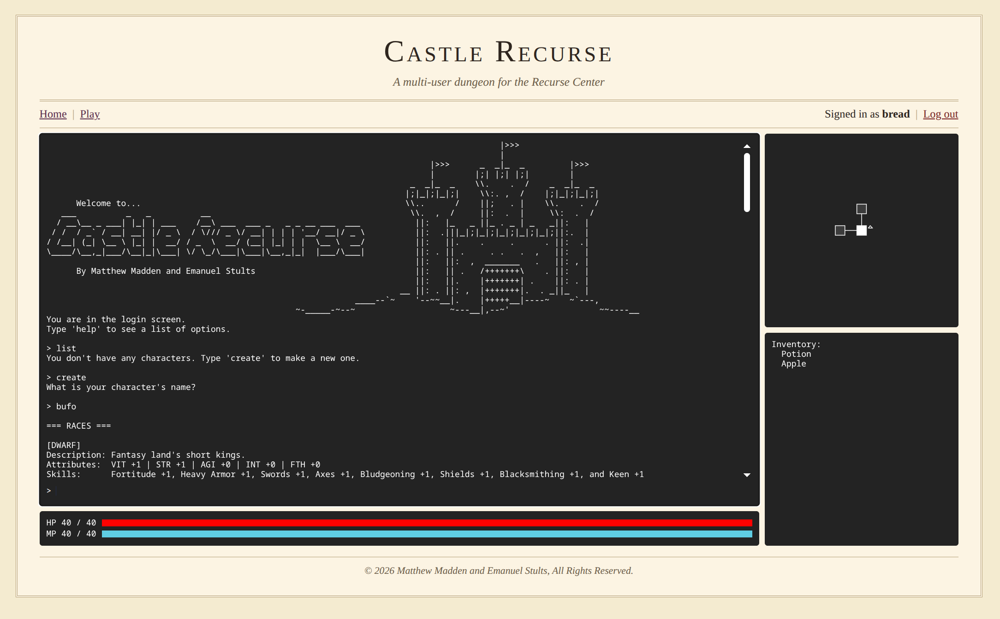
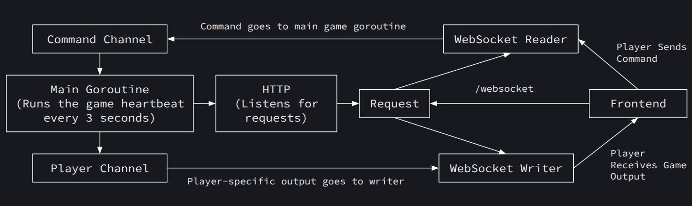
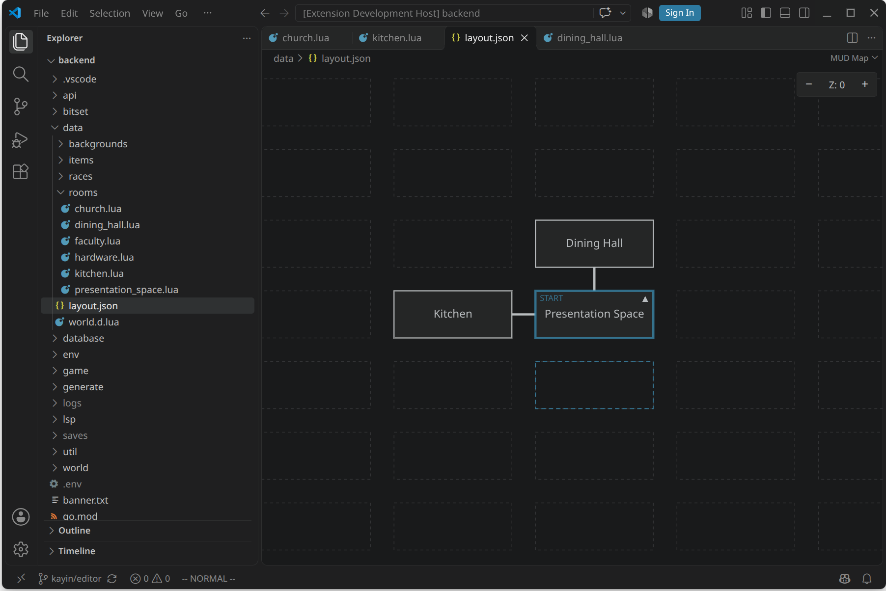

# Castle Recurse



Castle Recurse is a [Multi-User Dungeon](https://en.wikipedia.org/wiki/Multi-user_dungeon) (a multiplayer online text adventure game) developed for the Recurse Center. The game is still in active development.

## Dependencies
 - Go
 - NodeJS
 - NPM

 ## Running the Project
 
1. Clone the repo
2. Copy `backend/.env.example` to `backend/.env` and fill in the values.
3. Run the backend in one terminal
```
cd backend
go run .
```

4. In another terminal, install frontend dependencies and run the frontend
```
cd frontend
npm install

npm run dev
```

5. Access the frontend by navigating to `localhost:5173` in your browser.

## Project Architecture

The game runs on a Go backend server and players connect using a companion React frontend. The frontend contains no game logic and is just a plain terminal which sends and receives messages.

Users login from the frontend via username and password auth. Once logged in, their client establishes a websocket connection with the server, and the rest of gameplay happens through this websocket connection.

Since this is a realtime multiplayer game, good concurrency is an important part of keeping the game running. Pictured below is a flow of the game's concurrency scheme.



- The main goroutine handles gameplay
  - Gameplay happens on a 3 second server tick
  - All game logic is single-threaded 
- A separate goroutine runs an HTTP server and listens for requests
  - Each new HTTP request spawns a separate goroutine to handle the request (this is the default behavior for http in Go)
- When a websocket connection is made between client and server, two goroutines are established to run the connection
  - The WebSocket Reader routine listens for messages from the client and sends them to the game
  - The WebSocket Writer routine listens for messages from the game and sends them to the client
  - Go's channels feature is used to facilitate this communication. Messages can be sent between the game and the client's web socket connection without explicit synchronization on the application side

## World Editor



The world editor is built on VS Code and has two parts:

- **`mud lsp`**, a language server in the Go backend (`backend/lsp/`). It validates the world's data folder (the Lua scripts and `layout.json`) with the same loader the game server uses, and reports problems as you type, including problems that span files, such as a room whose loot names a deleted item. Because it is a standard language server, any editor with LSP support can use it.
- **A VS Code extension** (`editor/`). It runs `mud lsp` for the workspace and opens `layout.json` as a map, where you can create, move, connect and delete rooms, set the start room, and assign each room its Lua file.

To build and install the editor:

1. Build the `mud` binary that the extension runs:
```
cd backend
go build -o mud .
```
2. Build the extension. This writes `editor/mud-editor-<version>.vsix`:
```
cd editor
npm install
npm run package
```
3. Install the `.vsix` in VS Code, either by running "Extensions: Install from VSIX…" from the command palette and choosing the file, or from the command line:
```
code --install-extension editor/mud-editor-<version>.vsix
```
4. Open the `backend/` folder in VS Code (the folder that contains `data/`, not `data/` itself). Point the extension at the binary from step 1 by creating `backend/.vscode/settings.json` (or put `mud` on your `PATH` instead):
```json
{
    "mud.serverPath": "./mud"
}
```
5. Open `data/layout.json` to see the map. Problems in the data folder show up in the Problems panel and in open files.

Rebuild the binary after changing the Go code, then run "Developer: Reload Window" to restart the language server.

See [editor/README.md](./editor/README.md) for the extension's settings, the map controls and development, [World Editor](./docs/editor.md) for the editor's architecture, and [Language Server](./docs/backend/lsp.md) for what `mud lsp` validates.
