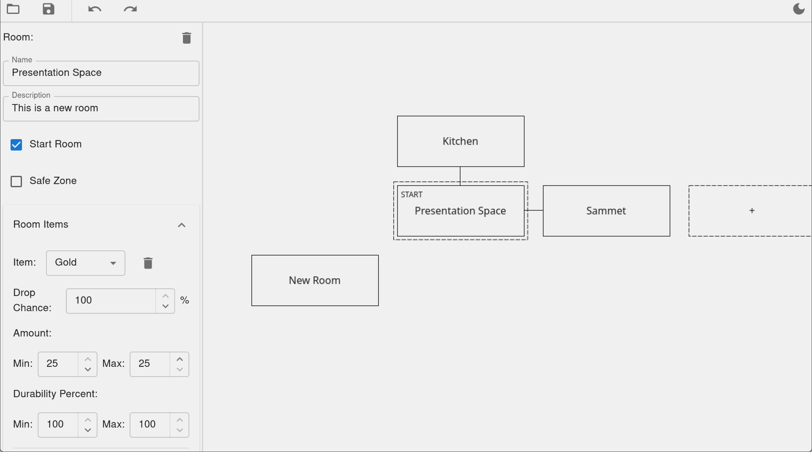

# World Editor

The world editor is a page of the web client (`/editor`, code in `frontend/src/editor/`) for editing `data/world.json` without typing out the JSON. It edits rooms, exits, locks, room drop tables and chests, and the NPCs placed in each room. Items, spells, NPC definitions and other script content are still edited by hand in the Lua files under `backend/data/`.



## Editor mode

The game server only enables the editor when it runs with the `--edit` command line flag. Without it, the editor's API routes aren't registered (`/api/editor/*` returns 404) and the `/editor` page only shows a message saying the editor is disabled.

Editor mode is for an author's own machine. The editor writes `world.json` in the data folder the server runs from, so a deployed server must never run with `--edit`.

Only gods can use the editor. Every editor route is wrapped in `requireGod` (`backend/api/editor.go`), which checks the session cookie against `GOD_USER_IDS`. The page asks `GET /api/auth/config` whether the editor is enabled (`editor`) and whether the user is a god (`god`) before it shows anything. The editor routes are also left out of `corsMiddleware`'s wildcard origin, since they write files.

## Running it

During development, run the backend with `--edit` and Vite next to it:

```
cd backend
set -a; . ./.env; set +a
go run . --edit
```

```
cd frontend
npm run dev
```

Log in at `localhost:5173` as a user listed in `GOD_USER_IDS` (with `ENABLE_DEBUG_AUTH=true`, the debug login works), then open `localhost:5173/editor`.

To run it without Vite, build the frontend into the server and run the binary with `--edit`:

```
cd frontend && npm run build
cd ../backend && go build -tags embed && ./mud --edit
```

## Saving and reloading

- **Save** (Ctrl+S, or the toolbar button) sends the editor's world to `PUT /api/editor/world`. The server converts it to the world file format (`encodeWorld` in `backend/api/editor_world_file.go`) and writes `world.json` atomically, so a failed conversion or write never leaves a broken file. Saving doesn't change the running game.
- **Reload** (toolbar button) calls `POST /api/editor/reload`, which asks the game loop to rebuild the world from the files in the data folder. It's the same reload as the `/reload` god command. Unsaved changes aren't included, so save first. After a successful reload the editor fetches the item and NPC data again, since the scripts may have changed.

A reload builds a new world next to the running one. If the new world has problems, the editor shows them and the running world is untouched. Otherwise online players are saved and spawned into the new world in the same room (or room 0 if their room is gone), and transient state such as NPCs, room items, combat and conditions is reset. See [Loading and reloading](backend/scripting.md#loading-and-reloading) for how loading and validation work.

## API

The routes are registered by `ApiState.RegisterEditorRoutes` (`backend/api/editor.go`). Errors come back as plain text, which the editor shows as is.

| Route | Description |
| --- | --- |
| `GET /api/editor/constants` | World constants the editor needs (`ROOM_NONE`, `WORLD_SECONDS_PER_UPDATE`) |
| `GET /api/editor/items` | `ITEM_DATA` |
| `GET /api/editor/npcs` | `NPC_DATA`, including each NPC's behavior param schema |
| `GET /api/editor/world` | `world.json`, converted to the editor's format (`EditorWorld`) |
| `PUT /api/editor/world` | Converts an `EditorWorld` back to the world file format and saves it |
| `POST /api/editor/reload` | Reloads the running world from the data folder |

The handlers never touch `GameState` or `World`, since all game state belongs to the game loop. They read and write files, and they read the script data globals (`ITEM_DATA` etc.) while holding the script data read lock (`withScriptDataReadLock`), since a reload replaces those globals. The reload handler sends a `game.ReloadRequest` into `GameState.ReloadRequests` and waits on its reply channel, and it must not hold the read lock, because the reload takes the write lock.

## Frontend architecture

- `editor_page.tsx` checks the auth config, loads the constants and renders `editor.tsx`, which lays out the canvas, the toolbar and the sidebar.
- `canvas/` draws the room grid and the connections between rooms. Rooms sit on grid cells.
- `sidebar/` edits the selected room or connection. Each section (NPCs, chests, locks, drop tables, behavior params) is a component in `sidebar/components/`.
- `toolbar/` has Save, Reload and the theme toggle, and handles the Ctrl+S, Ctrl+Z and redo shortcuts.
- `api/editor_api.ts` wraps the routes above. `api/models.ts` is generated (see below).

### Store and undo/redo

The editor's state (`EditorState`: rooms by cell, connections, the selection, and the loaded script data) lives in an external store, `editorStore` (`store/store.ts`). Components read it through `subscribe` and `emitChange`.

Every change to the world is an `EditorAction` (`store/action.ts`) with a `do` and an `undo`, applied through `editorStore.doAction`. The store keeps a history of actions for undo and redo, and it compares the top of the history with the action at the last save to decide whether there are unsaved changes. To add a new kind of edit, add a new `EditorAction` class instead of changing the state directly.

The editor's format differs from the world file. Rooms are keyed by grid cell instead of by index, and exits are stored as connections between cells. `toEditorWorld` turns the state into an `EditorWorld` for saving, and the server turns each connection into a pair of exits.

## TypeScript types

The editor uses TypeScript versions of the Go types its API sends (`api.EditorWorld`, `world.Room`, the enums in `backend/enums.go`, ...). They live in `frontend/src/editor/api/models.ts`, which is generated, so don't edit it by hand. After changing any of those Go types, regenerate it:

```
cd backend
go generate
```

`backend/main.go` has a `//go:generate go run . -generate-editor-models ../frontend/src/editor/api/models.ts` line. With that flag, `main()` calls `generateModels()` (`backend/models_gen.go`) instead of starting the server. `generateModels()` walks the registered Go types with reflection, converts them with a copy of Wails' typescriptify (`backend/internal/typescriptify`), and writes the result. `go generate` also regenerates the Lua definitions in `data/world.d.lua`.
